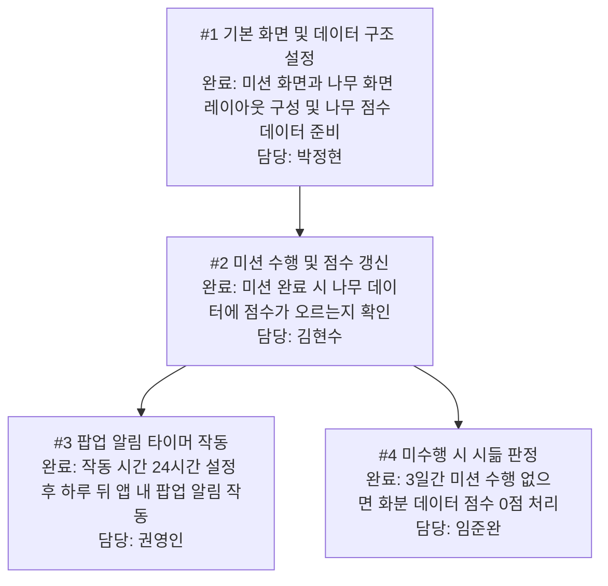

# 5주차 활동지 / Week 5 Worksheet

**1-page 기획서 / One-page plan**

- 작성일 / Date: 2026-09-30
- 참여자 / Present: 박정현, 김현수, 권영인, 임준완

---

## ① 주제 확정 / Confirm topic

- 확정 주제 / Topic: 긍정적인 도파민이 나올 수 있도록 도와주는 프로그램
- 이유 / Reason: 스마트폰 과의존 위험에서 벗어나 산책, 명상 등의 건강한 활동으로 긍정적인 도파민을 얻도록 돕고, 나무를 기르는 성취감을 통해 좋은 습관을 형성하기 위함

---

## ② 태스크 분해와 의존 관계 / Tasks and dependencies

### 태스크 목록 / Task list

4주차 사용자 스토리와 완료 조건을 태스크로 나눕니다.
*Break down your Week 4 user stories and acceptance criteria into tasks.*
x
각 태스크는 따로 끝내도 맞는지 확인할 수 있어야 합니다. 담당에 '다 같이'는 쓰지 않습니다.
*Each task must be checkable on its own. Do not write "everyone" as owner.*

| # | 태스크 Task | 완료 조건 Done when | 선행 태스크 Depends on | 담당 Owner |
|---|---|---|---|---|
| 1 | 기본 화면 및 데이터 구조 설정 | 미션 화면과 나무 화면 레이아웃이 구성되고, 나무 점수 데이터가 준비된다 | #1 | 박정현 |
| 2 | 미션 수행 및 점수 갱신 | 미션 완료 시 나무 데이터에 점수가 오르는지 확인한다 | #2 | 김현수 |
| 3 | 팝업 알림 타이머 작동 | 작동 시간을 24시간으로 둔 후, 하루 뒤 앱 내에 팝업 알림이 뜬다 | #3 | 권영인 |
| 4 | 미수행 시 시듦 판정 | 3일로 잡고 관측했을 때, 미션 수행이 없으면 화분 데이터 점수가 0점이 된다 | #3 | 임준완|

### 의존 관계 그래프 / Dependency graph (DAG)

화살표는 "앞 태스크가 끝나야 뒤 태스크를 할 수 있다"는 뜻입니다.
*An arrow means the first task must finish before the second can start.*

**그리는 방법 / How to draw**
- 아래 예시에서 상자 이름을 바꾸고, 선후 관계 하나마다 화살표(`-->`) 줄을 하나씩 추가합니다. GitHub에서 파일을 열면 그림으로 보입니다. 미리 보려면 mermaid.live에 붙여 넣으세요.
  *Rename the boxes and add one `-->` line per dependency. GitHub shows it as a diagram. Preview at mermaid.live.*
- 태스크 표를 AI에게 주고 "Mermaid 그래프로 바꿔 줘"라고 요청해도 됩니다.
  *You can also give the task table to AI and ask "Convert this into a Mermaid graph."*
- 어려우면 종이에 그려 사진을 `docs/images/`에 올리고 ``로 넣어도 됩니다.
  *Or draw it on paper, upload the photo to `docs/images/` and link it with ``.*

- 지금 착수 가능 (진입 차수 0) / Can start now (in-degree 0): #2,#4
- 작업 순서 (위상정렬) / Work order (topological sort): #2,#4 -> #3-> #1
- 사이클이 있었다면 어떻게 풀었는가 / If there was a cycle, how did you fix it?: 원래 표에서는 #1 ↔ #4가 서로를 선행 태스크로 지정해 순환이 있었고, #3은 자기 자신을 선행 태스크로 갖고 있었습니다. 태스크 내용상 "설정과 on/off 기능 → 사용시간 측정 → 화면 밝기 줄이기" 순서가 자연스러워서, #1의 선행을 #4에서 #3으로, #3의 선행을 #3(자기 자신)에서 #2, #4로, #4의 선행을 #1에서 없음으로 바꿔 순환을 끊었습니다. 그 결과 #2는 선행 없음(#1이 가지던 의존도 제거), #4는 선행 없음이 되었습니다.

---

## ③ 범위 결정 / Scope

### Must — 없으면 성립 안 됨 / essential

핵심 시나리오 1개가 끝까지 동작하는 데 필요한 것만 / *Only what the core scenario needs to work end-to-end*

- 핵심 시나리오 / Core scenario: 미션(활동)을 수행하면 화분 데이터 점수가 1점 오르고 나무 화면이 갱신되는 것

### Should (없을 경우에는 작성하지 마세요)
 
 - 시나리오 : 3일간 미션을 수행하지 않으면 화분 점수가 0으로 내려가는 시듦/페널티 기능

### Could (없을 경우에는 작성하지 마세요)

 - 시나리오 : GPS 기반 실제 산책 거리/시간 측정 연동 (초기에는 단순 버튼 인증으로 대체 가능)

### **Won't — 이번 학기에 안 함 / not this semester**

| Won't 항목 Item | 포기한 이유 Why |
|---|---|
| 사용자 간 친구 맺기 및 나무 성장 비교 소셜 기능 | 핵심인 '개인의 긍정적 도파민 형성'과 무관하며 남은 기간 내 구현 범위가 너무 큼 |
|  |  |

### 실행 가능성 확인 / Feasibility check

- 특수 장비·유료 API·실제 개인정보가 필요한가? 필요하다면 대안은?
  *Does it need special hardware, paid APIs or real personal data? If so, what is the alternative?*
  없다
- 15주차에 발표장에서 시연할 수 있는 형태인가?
  *Can it be demonstrated live in Week 15?*
  예
---

## ④ 가장 먼저 동작시킬 흐름 (Walking Skeleton) / First end-to-end flow

예 / Example: 과제 ID를 입력하면 → LMS에서 제출 기록을 받아 와서 → 화면에 제출 인원 숫자 하나가 뜬다

> [무엇을 입력하면] → [무엇을 처리해서] → [화면에 무엇이 나온다]
>
> 앱을 실행하여 미션 기록 화면에서 미션 완료 버튼을 클릭하면 ➔ 화분 물주기 엔진이 DB의 화분 점수를 1점 추가 처리해서 ➔ 화분 화면에 증가된 점수와 갱신된 나무 상태가 나온다

---

> 수업 종료 시 커밋하세요 / Commit this at the end of class
> `git add docs/week-05.md && git commit -m "docs: 5주차 활동지 작성"`
