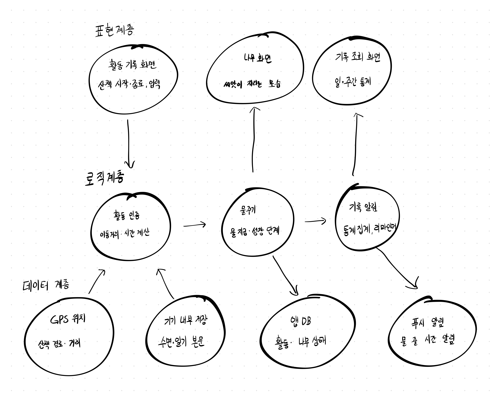

# Week 07 팀 활동지 / Team Activity

| 팀명 / Team | 작성일 / Date | 참여자 / Members |
|---|---|---|
| | | |

## 1. 아키텍처 다이어그램 / Architecture Diagram

손그림 사진을 올리고 링크하십시오 / Upload a photo and link it.

| 계층 / Layer | 모듈·파일 / Modules | 의존하지 않는 것 / Does not depend on |
|---|---|---|
| 표현 / Presentation | 활동 기록 화면, 나무화면, 기록조회 화면 | 활동 인증 규칙, 성장-시듦규칙, 데이터출처(GPS,DB 종류) |
| 로직 / Logic | 활동인증, 물주기엔진, 시름판정, 기록-알림 | 화면종류, 저장방식(DB종류, 로컬/서버), 푸시서비스 종류 |
| 데이터 / Data | GPS위치, 기기 내부 저장, 앱(DB), 푸시알림 | 인증규칙, 성장-시듦 규칙, 화면 구성 |

## 2. 이슈 / Issues

> 이슈 = **앞으로 할 일** / An issue is work to be done.
> 개발할 때 커밋에 이슈 번호를 붙이고(`#3 알레르기 필터 추가`), 완료 조건을 만족하면 이슈를 닫습니다.
> Add the issue number to commits, and close the issue when its criteria are met.

| # | 제목 / Title | 라벨 / Label | 담당 / Assignee | 완료 조건 / Acceptance Criteria |
|---|---|---|---|---|
| 예시 #3 | 알레르기 필터 | backend | 홍길동 | '땅콩'을 선택하면 땅콩이 들어간 메뉴가 추천 결과에서 빠진다 |
| 1 | 프로젝트 초기설정 | setup | 권영인 | 표현,로직,데이터 3계층 폴더 구조가 있고, 빈 앱이 빌드 실행된다 |
| 2 | DB스키마 생성 | data | 박정현 |  ERD의 6개 테이블이 생성되고, 활동 5종과 성장단계 초기 데이터가 들어있다 |
| 3 | GPS산책 기록 | data | 박정현 | 산책 시작~종료 동안 위치를 수집해 거리-시간을 계산한다. 좌료는 서버로 보내지 않는다 |
| 4 | 활동인증규칙 | logic | 임준완 | 활동별 완료 조건을 판정한다. 편균 시속 7km초과 산책은 인정하지 않는 테스트가 통과한다. |
| 5 | 물주기 | logic | 임준완 | 인증 1건당 보상만큼 물이 쌓이고, 기준량에 도달하면 다음 단계로 바뀌는 테스트가 통과한다 |
| 6 | 활동기록 화면 | frontend | 김현수 | 활동 5종을 선택해 기록할 수 있고, 인증 성공-실패 결과가 화면에 표시된다. |
| 7 | 나무화면 | frontend | 김현수 | 현재 성장 단계와 물의 양이 표시되고, 활동 인증 직후 갱신된다 |
| 8 | 일기로컬저장 | data | 박정현 | 일기 본문은 기기에만 저장되고, 서버에는 작성 여부만 기록된다 |
| 9 | 명상인증 | logic | 임준완 | 정해진 클래식 음악이 끝까지 재생되는 동안 다른 조작이 없으면 인증된다. 도중에 앱을 벗어나거나 화면을 조작하면 실패 처리된다 |
| 10 | 독서인증(독후감) | logic | 임준완 | 독서 후 독후감을 기준 분량(예: 200자) 이상 작성하면 인증된다. 기준 미만이면 저장은 되지만 인증되지 않는다 |
| 11 | 수면기록 | data | | 취침·기상 시각을 기록하고, 기준 시간 이상이면 인증된다 |
| 12 | 기록 조회 화면 | frontend | 김현수 | 일·주간 활동 횟수와 받은 물의 양이 표시된다 |
| 13 | 물주기 리마인더 | feature| 권영인 | 사용자가 설정한 시각에 푸시 알림이 온다 |
| 14 | 나무 완성과 새 씨앗 | feature | 김현수 | 마지막 단계에 도달하면 나무가 완료 처리되고 새 씨앗이 심어진다 |
| 15 | 시듦판정 | logic | 임준완 | 마지막 인증 활동 후 기준 기간(예: 3일)이 지나면 나무 상태가 시듦으로 바뀌고 나무 화면에 표시된다. 시들기 하루 전에 경고 푸시가 간다 |

## 3. 마일스톤 / Milestones

| 마일스톤 / Milestone | 마감 / Due | 포함 이슈 / Issues |
|---|---|---|
| MVP 완료 | 11주차 | 1, 2, 3, 4, 5, 6, 7 |
| 실행 패키지 | 13주차 | 8, 9, 10, 11, 12, 13, 14, 15 |

> AI를 사용했다면 `PROMPTS.md`에 기록 / Log any AI use in `PROMPTS.md`
